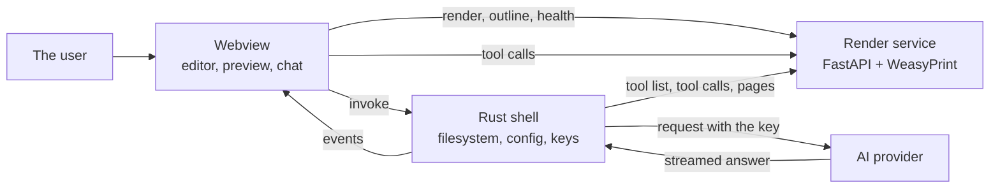

# Architecture

How the pieces fit together, and why they are shaped this way.

## The parts

```
apps/desktop       Tauri 2 + React + TypeScript desktop app
apps/api           FastAPI render service (Python 3.12 + WeasyPrint)
packages/protocol  Types shared between the app and the service
examples/welcome    A sample project to open and try
```

The shell is thin. The webview holds the editor, the preview and the
assistant's chat; the Rust side holds the filesystem, the configuration and
the API keys. The render service is a separate process, because the layout
engine is Python and because a service that can be run on its own is a
service that can be tested on its own.

## The name

The product is called **YueMi Office**, and that is the name the README
gives it. The lowercase `yuemi` is the name of the built artefact: the
window title, the bundle identifier, the file names of the installers and
the release names. The two are different things, and the product name is
not the one that changes.



The key is the reason the shell is in the middle. The key never enters the
webview, so the request that carries it cannot be made from there. The
renders go straight from the webview to the service, because a PDF is a lot
of bytes to carry through the shell for no gain. The shell goes to the
service as well, for the pages it shows the model and for the tool calls
the model asked for.

Both sides reach the service for tools. The chat runs in the shell, so the
shell asks the service what tools exist and runs the calls the model made.
The app also runs a scripted session of its own, without a model, and that
runs in the webview, so it calls the service from there.

## A document is a folder

A document is a plain-text folder that works with git:

```
my-document/
├── project.json     the manifest
├── content/         Markdown files, in document order
├── styles/          CSS files, in cascade order
├── assets/          images
└── fonts/           font files the document bundles
```

`project.json` lists content and styles as explicit ordered arrays rather
than directory globs, so the same project renders identically on every
operating system. A glob would depend on the order the filesystem hands
the names back, and that order is not the same everywhere.

## The preview is the document

The PDF preview is not an approximation of the export. Both come from the
same render, and the bytes the preview shows are the bytes the export
writes. They cannot drift apart, because there is only one of them.

## The render service

The service listens on port 32100. The port is named once in
`packages/protocol/src/index.ts` and once in `apps/api/app/service.py`, and
a test keeps the two in step, along with the image that publishes it, the
compose file, the app's own content security policy, and the CI job that
smoke-tests it.

The port sits in the 32000–32767 band: above the ports software listens on
by default, and below the range the operating system hands out to
short-lived connections, where a service can have its port taken away from
under it.

| Endpoint | What it does |
|---|---|
| `GET /v1/health` | Reports that the service is up and which engine version it uses |
| `POST /v1/render` | Renders a project and returns the PDF bytes |
| `POST /v1/render/pages` | Renders a project and returns the pages as images |
| `POST /v1/render/outline` | Returns the outline of a project |
| `GET /v1/ai/tools` | Lists the tools the assistant may call |
| `POST /v1/ai/session` | Runs the tools the assistant asked for |

The warnings and the outline travel back in the `X-Warnings` and
`X-Outline` headers, so the client can show a preview after a single
request instead of rendering the document twice. A payload that is too
large for a header comes back empty, and the client asks for it separately
rather than receiving a broken response.

The service allows the origins the app runs on: the dev server, and the
packaged app's own `tauri://` or `http://tauri.localhost` origin. Without
those the packaged app cannot reach the service at all.
