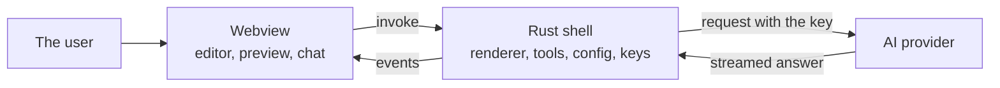
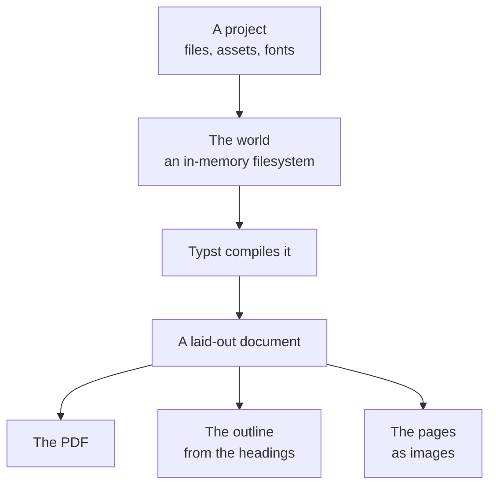

# Architecture

How the pieces fit together, and why they are shaped this way.

## The parts

```
apps/desktop       Tauri 2 + React + TypeScript desktop app
apps/desktop/src-tauri
                   The Rust side: the renderer, the assistant, the keys
packages/protocol  Types shared between the Rust side and the webview
examples/welcome    A sample project to open and try
```

The shell is thin. The webview holds the editor, the preview and the
assistant's chat; the Rust side holds the renderer, the filesystem, the
configuration and the API keys.

There is no service. The renderer is a Rust library inside the app, and the
assistant's tools run in the same process. The reason is that both halves
of the work need the layout engine, and a library that both can call is
cheaper than a service that both have to reach.



The key is the reason the shell is in the middle. The key never enters the
webview, so the request that carries it cannot be made from there. The
renders go from the webview into the shell, and the shell lays the document
out and hands the PDF bytes back.

The shell also keeps the configuration folder, `~/.yuemi-office/`: the
configuration itself, the API keys, and the catalogue of model sizes taken
from models.dev. The keys are apart from the rest because the
configuration is the file a user would paste into an issue.

## A document is a folder

A document is a plain-text folder that works with git:

```
my-document/
├── project.json     the manifest
├── content/         Typst files, in document order
├── theme.typ        the stylesheet
├── assets/          images
└── fonts/           font files the document bundles
```

`project.json` lists the content files as an explicit ordered array rather
than a directory glob, so the same project renders identically on every
operating system. A glob would depend on the order the filesystem hands
the names back, and that order is not the same everywhere.

The theme is a Typst file that exports a `theme` function. It is the
project's stylesheet: the fonts, the heading styles, the page furniture.

```typst
#let theme(body) = {
  set page(paper: "a4", margin: 22mm)
  set text(font: "Source Serif 4", size: 11.5pt)
  body
}
```

The renderer imports it and wraps the content in it, so every document of
the project gets the same page geometry without repeating it in each file.

## The preview is the document

The PDF preview is not an approximation of the export. Both come from the
same render, and the bytes the preview shows are the bytes the export
writes. They cannot drift apart, because there is only one of them.

## The renderer

The renderer is `apps/desktop/src-tauri/src/render.rs`. It compiles a
`typst` document into a PDF, an outline and a set of page images, and it
does so without touching the disk: everything it needs arrives in the
request, as the files, the assets and the fonts of the project. A document
can therefore be rendered from files that never existed on a filesystem.



The world is an in-memory filesystem. A file that is in the request is in
it, and a file that is not is not there: a missing image is a warning and
the rest of the document still renders, and a missing theme is an error,
because a document without its stylesheet is not the document the user
wrote.

The pages are rasterised with Typst's own renderer rather than the
system's, so the pages of the same document are the same on Windows, macOS
and Linux. That is what makes a committed visual baseline worth having.

## The assistant's tools

The tools run in the same process, in `ai_tools.rs`, and they work on the
project as it is in memory rather than on the files on disk. The model
never writes a file: every change goes through `propose_edit` or
`propose_style` and reaches the document only after the user accepts it.

Six tools are on offer: `list_sections`, `read_section`, `search`,
`propose_edit`, `propose_style` and `render_preview`. See
[docs/assistant.md](assistant.md) for what each one does.
