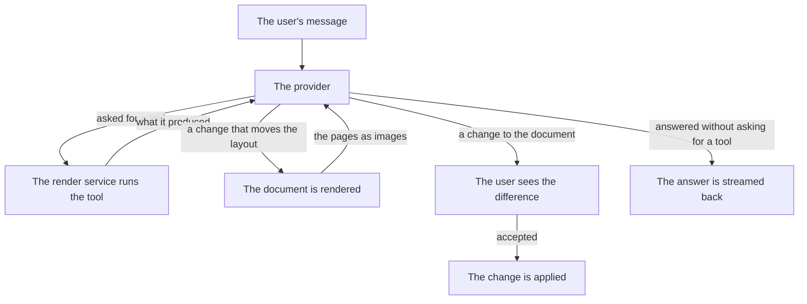

# The assistant

The assistant is a loop rather than a single question. It sends the
conversation to the provider, runs the tools the model asks for, sends the
results back, and goes round again until the model answers without asking
for anything. A change that affects the layout is rendered and the pages
are shown to the model, so it can see what it did rather than only being
told.

The model never writes a file. Every change goes through `propose_edit` or
`set_style` and reaches the document only after the user accepts it. The
model cannot reach outside the project folder and cannot run commands.

Six tools are on offer: `list_sections`, `read_section`, `search`,
`propose_edit`, `set_style` and `render_preview`.



The loop stops when the model answers without asking for a tool, when the
user stops it, or after twelve rounds of tools. The limit is high enough
for real work and low enough that a model which keeps asking for the same
thing is noticed.

The pages are only sent to a model that can look at images. A provider
without that ability is told what the renderer found instead, so it is
never left guessing about the layout.

## Where the run happens

The chat runs in the Rust shell, not in the webview. The webview sends the
conversation to `run_assistant` and receives the events of the run back as
they happen: pieces of the answer, the tools the model asked for, what
those tools produced, the changes they proposed, the rendered pages after a
layout change, and the end of the run.

The run is in the shell because the key is. A key never travels into the
webview, so the request that carries it cannot be made from there.

The render service does the work the tools describe. The shell asks it
what tools exist, runs the calls the model made against the project, and
sends the answers back to the model.

## Providers and keys

Three wire formats are supported: Anthropic's Messages API, OpenAI's Chat
Completions API, and any other server that speaks the second one — Ollama,
LM Studio, OpenRouter, vLLM. A custom provider is added in the settings
dialog by giving it an address and a format.

The keys live in the user's home folder, under `~/.yuemi-office/`:

```
~/.yuemi-office/
├── config.json       the providers, the active model, the settings
└── credentials.json  the API keys, one per provider
```

They are kept apart because `config.json` is the file a user would paste
into an issue, and a key in it would be a leak. The key never travels back
to the webview either: the app asks the shell to set a key and is told only
whether one is there.

Both files are written by writing a temporary file next to them and moving
it into place, so an interrupted write leaves the old file whole instead of
a half-written one that cannot be read.

## The settings dialog

The settings dialog has one **Save** button, and it saves everything on it:
the address of the render service, the providers, the provider that is
active, the model, and whether the assistant is allowed to run. A key has its
own button next to the field it is pasted into, and saving a key does not
touch the rest of the form. Removing a provider and saving clears the key
that belonged to it.

The setting that turns the assistant off is honoured by the shell as well
as by the window, so a run cannot be started from outside the app when the
document's contents are not meant to leave the machine.

## Trying a provider

Each provider has its own **Test provider** button. The button tries the
provider as the form shows it, not as it was last saved, so a new provider
or a changed address can be tried before the settings are kept. The answer
is shown under the provider it belongs to, and a failure says why: a missing
address, a missing key, a key the provider refused, or a provider that did
not answer within thirty seconds. A key that has only been typed is used as
it is, so the provider can be tried before the key is saved.

The key that was saved is not sent to the shell with the test. The shell
looks it up by the provider's identifier in the user's home folder, so the
webview never holds one. A key that has only just been typed is sent,
because the shell has no key of its own to give.

## Choosing a provider

The provider the user picked in the settings wins. If none is picked, the
first provider that has a key is used, so the app works as soon as one
provider is set up. The model is the one chosen for the request, or the
provider's own model, or none at all — in which case the run is refused
rather than sent with an empty model name.
