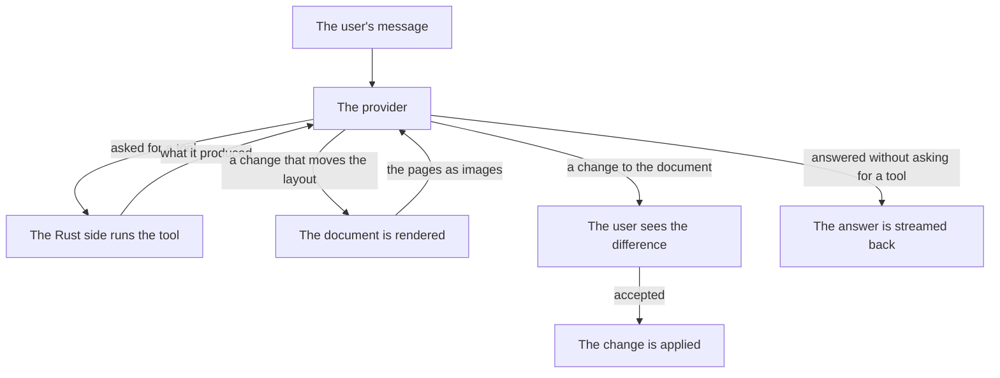
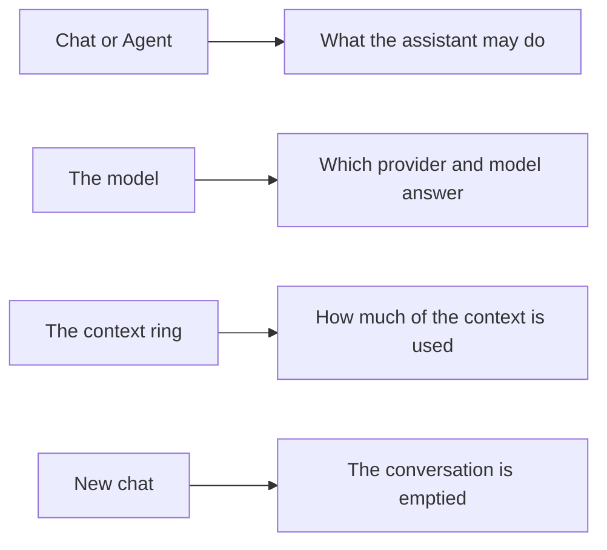

# The assistant

The assistant is a loop rather than a single question. It sends the
conversation to the provider, runs the tools the model asks for, sends the
results back, and goes round again until the model answers without asking
for anything. A change that affects the layout is rendered and the pages
are shown to the model, so it can see what it did rather than only being
told.

The model never writes a file. Every change goes through `propose_edit` or
`propose_style` and reaches the document only after the user accepts it. The
model cannot reach outside the project folder and cannot run commands.

Six tools are on offer: `list_sections`, `read_section`, `search`,
`propose_edit`, `propose_style` and `render_preview`.

## A change is checked before it is offered

A change that would break the document is refused before the user is ever
asked about it. The check is made on the document as it would be if the
user kept the changes proposed so far, so a change is judged against the
document it belongs to and not against the document as it was when the
session started.

Two things are checked. The first is the file itself: a file that does not
parse is a file the renderer cannot use, and the usual cause is a reply
that stopped part way through and left the file cut off in the middle of a
block. The second is the document as a whole: a file can parse and still
not compile, e.g. when a `show` rule names a variable that is not there.
The document is compiled with and without the change, and the change is
only held against it when the document compiled before and does not
compile after. A document that was already broken is not held against a
change, so the assistant is free to repair it.

A refused change is not an error the user has to read. The assistant is
told what went wrong and is asked to write the whole file again, including
the parts it did not change. The file is left as it was.

## A style goes where it works

A `set` rule applies to the content that follows it, and a `show` rule
replaces what it shows, so both only reach the document when they are
inside the `theme` function and in front of the body it wraps. A style
that is added after the function would be read but never reach the
document, so a new rule is written inside the function instead. A `let`
binding is read wherever it is used, so it goes next to the function
rather than inside it.

A `show` rule needs a recipe. The recipe takes the shown content as `it`,
so a rule that is written as a plain call and uses `it` is turned into a
closure: `block(above: 0pt, it)` becomes `it => block(above: 0pt, it)`.
Without that, `it` is a name nobody has bound and the document fails to
compile. A rule that is already a recipe is left as it is.



The loop stops when the model answers without asking for a tool, when the
user stops it, or after twelve rounds of tools. The limit is high enough
for real work and low enough that a model which keeps asking for the same
thing is noticed.

The pages are only sent to a model that can look at images. A provider
without that ability is told what the renderer found instead, so it is
never left guessing about the layout.

## Where the run happens

The chat runs in the Rust shell, not in the webview. The webview sends the
conversation to `run_assistant` and receives the events of the run back as
they happen: pieces of the answer, the tools the model asked for, what
those tools produced, the changes they proposed, the rendered pages after a
layout change, and the end of the run.

The run is in the shell because the key is. A key never travels into the
webview, so the request that carries it cannot be made from there.

The tools run in the shell, in the same process as the renderer. The
shell knows what tools exist, runs the calls the model made against the
project, and sends the answers back to the model.

## Providers and keys

Three wire formats are supported: Anthropic's Messages API, OpenAI's Chat
Completions API, and any other server that speaks the second one — Ollama,
LM Studio, OpenRouter, vLLM. A custom provider is added in the settings
dialog by giving it an address and a format.

The keys live in the user's home folder, under `~/.yuemi-office/`:

```
~/.yuemi-office/
├── config.json       the providers, the active model, the settings
└── credentials.json  the API keys, one per provider
```

They are kept apart because `config.json` is the file a user would paste
into an issue, and a key in it would be a leak. The key never travels back
to the webview either: the app asks the shell to set a key and is told only
whether one is there.

Both files are written by writing a temporary file next to them and moving
it into place, so an interrupted write leaves the old file whole instead of
a half-written one that cannot be read.

## The settings dialog

The settings dialog has one **Save** button, and it saves everything on it:
the providers, the provider that is active, the model, and whether the
assistant is allowed to run. A key has its
own button next to the field it is pasted into, and saving a key does not
touch the rest of the form. Removing a provider and saving clears the key
that belonged to it.

The setting that turns the assistant off is honoured by the shell as well
as by the window, so a run cannot be started from outside the app when the
document's contents are not meant to leave the machine.

## Trying a provider

Each provider has its own **Test provider** button. The button tries the
provider as the form shows it, not as it was last saved, so a new provider
or a changed address can be tried before the settings are kept. The answer
is shown under the provider it belongs to, and a failure says why: a missing
address, a missing key, a key the provider refused, or a provider that did
not answer within thirty seconds. A key that has only been typed is used as
it is, so the provider can be tried before the key is saved.

The key that was saved is not sent to the shell with the test. The shell
looks it up by the provider's identifier in the user's home folder, so the
webview never holds one. A key that has only just been typed is sent,
because the shell has no key of its own to give.

## Choosing a provider

The provider the user picked in the settings wins. If none is picked, the
first provider that has a key is used, so the app works as soon as one
provider is set up. The model is the one chosen for the request, or the
provider's own model, or none at all — in which case the run is refused
rather than sent with an empty model name.

## The chat's toolbar

The toolbar at the top of the chat holds the three things that are changed
most often, so that none of them needs the settings dialog.



**Chat or Agent.** The chat mode answers questions about the document: the
model is only offered the tools that read it — `list_sections`,
`read_section` and `search` — so it cannot ask for a change. The agent mode
offers all six tools and may propose changes, which the user then accepts
or rejects. The mode is kept by what the model is given rather than by a
check afterwards, so there is one path through the loop for both.

**The model.** The models of every provider are in one list, grouped by the
provider they belong to, and choosing one chooses its provider as well,
because that is the pair the request needs. The choice is written to the
configuration, so it is still the one in use the next time the app is
opened. A provider may still be given a model by hand in the settings, for
a server the app knows nothing about.

**The context ring.** The conversation is kept: the finished turns are
resent with every run, so the conversation grows as the work goes on. The
ring shows how much of the model's context it takes up. It needs two
numbers:

- how much is used, which the provider reports and the app passes on;
- how large the context is, which comes from the models.dev catalogue.

The ring is drawn only when both are known. A provider that reports nothing
— a local server that ignores the request — leaves the size to be estimated
from the text, and the ring says that it is an estimate. A model the
catalogue does not know has no window, and then no ring is drawn at all: a
ring against a size nobody knows would be a number that cannot be stood
behind.

**New chat.** Empties the conversation, and the ring with it.

## The model catalogue

The sizes of the models are not in the app, because they change as
providers release models. They are read from [models.dev](https://models.dev/)
and kept in the configuration folder:

```
~/.yuemi-office/
├── config.json         the providers, the active model, the settings
├── credentials.json    the API keys, one per provider
└── models-cache.json   the sizes of the models, from models.dev
```

The catalogue is one document for every provider, so it is fetched once and
kept for a day rather than fetched for every question. A model is looked up
under the provider that offers it, and a model of a provider the catalogue
does not know — an OpenRouter address the user added by hand, say — is
looked up by its name under any provider, because the model is the same one
whoever serves it. The fetch is made by the shell rather than by the
webview, for the same reason the keys are: the configuration folder is
already where the app keeps what it needs.

