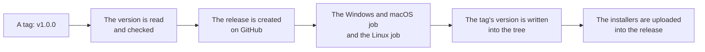

# Development

How to run the app, how to build an installer, and what CI does.

You need [Bun](https://bun.sh) and Rust.

## The desktop app

```bash
bun install
bun run dev:desktop
```

There is no service to start. The renderer is a Rust library inside the
app, so the same process that shows the preview lays the document out for
the export and for the pages the assistant is shown.

## Tests

```bash
bun run test
cd apps/desktop/src-tauri && cargo test
```

The visual check renders a reference document and compares the pages with
the committed baselines. To regenerate them after a change to the layout
that is meant to alter the output:

```bash
.github/scripts/visual-check.sh write
```

The baselines are PNG files under
`apps/desktop/src-tauri/tests/visual/baseline/reference`. Typst rasterises
with its own renderer, so the pages of the same document are the same on
every operating system, and one set of baselines serves all three.

## Building a binary

The installers for the platform you are on are built with one command:

```bash
bun run build:desktop
```

It prints what the platform needs before it starts, then runs `tauri build`. The
output lands in `apps/desktop/src-tauri/target/release/bundle`:

| Platform | Files |
|---|---|
| Windows | `yuemi_<version>_x64_en-US.msi`, `yuemi_<version>_x64-setup.exe` |
| macOS | `yuemi_<version>_aarch64.dmg`, `yuemi.app.tar.gz` |
| Linux | `yuemi_<version>_amd64.deb`, `yuemi-<version>-1.x86_64.rpm`, `yuemi_<version>_amd64.AppImage` |

The version in the file names comes from `apps/desktop/src-tauri/tauri.conf.json`.
`bun run set-version 1.0.0-beta` puts a different one there and in the other
files that carry it.

A pre-release is a version with a dash in it, and every platform builds one.
What the installers carry, and what the Linux packages carry, is not the same
thing:

| Platform | What it carries for `1.0.0-beta` |
|---|---|
| Windows | the installer shows `1.0.0-beta`; the MSI is built with the numbers `1.0.0.0` |
| macOS | the app shows `1.0.0-beta`; the build version is `1.0.0` |
| Linux | the file names say `1.0.0-beta`; the packages carry `1.0.0~beta` |

The tilde in the Linux packages is not a typo. Debian reads `1.0.0-beta` as
the upstream version `1.0.0` with the revision `beta`, and a revision sorts
after no revision at all, so the finished release would look older than the
pre-release and `apt` would not upgrade to it. `1.0.0~beta` says that the
revision sorts *before* the finished release, which is the order a pre-release
has to have. The tilde is also the only form of it that rpm accepts.

The rpm is the one package that cannot be built for a pre-release at all. Its
version has to be set while it is built, and the only version the bundler
takes is the one in the configuration, which has to be a plain semver version.
So a pre-release is built with the Debian package and the AppImage only:

```bash
bun run build:desktop --bundles deb,appimage
```

The Debian package is built with the version of the app in it, so it is
rewritten afterwards with the version that Debian reads in the right order.
That is what `.github/scripts/fix-deb-version.sh` does, and the release
workflow runs it before the package is uploaded.

The builds are not signed. Windows and macOS will warn about an application
from an unknown developer.

## The icons

The icons of the app are not kept in the repository. They are derived from one
picture, `.github/assets/Logo.png`, every time they are needed:

```bash
bun run icons
```

The Tauri CLI does the work, because it is the tool that knows which files
each platform's bundler wants. The pictures it writes land in
`apps/desktop/src-tauri/icons`, which is ignored by Git.

The derivation is a hook in the Tauri configuration, so it happens on its own:

```json
"beforeBuildCommand": "bun run icons && bun run build",
"beforeDevCommand": "bun run icons && bun run dev"
```

The order matters. The Rust side of the app reads the icon of the window into
the binary, and the bundler of every platform reads its own file out of the
same folder, so the icons have to be there before the Rust side is compiled
and not only before the installers are made.

One job does not get the hook: the CI job that runs `cargo test` calls cargo
directly rather than through the Tauri CLI, so the workflow writes the icons
itself before it runs the tests.

## The version

The whole repository has one version. It is released together from one tag,
and every place that carries a version carries the same number.

The version is declared in more than one place, because the toolchains do not
agree on where they read it:

| Project | File | What it holds |
|---|---|---|
| The repository | `package.json` | `version` |
| The desktop app | `apps/desktop/package.json` | `version` |
| The protocol package | `packages/protocol/package.json` | `version` |
| The desktop app | `apps/desktop/src-tauri/tauri.conf.json` | `version`, and the two versions the bundle formats need |
| The desktop app | `apps/desktop/src-tauri/Cargo.toml` | the version of the crate |
| The desktop app | `apps/desktop/src-tauri/Cargo.lock` | the version of the crate, as cargo records it |
| The repository | `bun.lock` | the versions of the workspace packages, as bun records them |

Two commands look after them:

```bash
bun run set-version 1.0.0-beta   # writes the version into every file
bun run version:report           # says what each file carries
```

`version:report` fails when the places disagree, and the ordinary CI runs
it, so a tree that would build the wrong thing is caught before a release
rather than after one.

A third command answers what the Linux packages would carry:

```bash
bun run package-version           # 0.1.0
bun run package-version 1.0.0-beta # 1.0.0~beta
```

The rules live in `apps/desktop/src/lib/version.ts`, which is where the
setters are and where the tests check them. A file that is added to the list
of version files is a file that the release workflow writes into, so a new
project has to be added there rather than left to be remembered.

The version of the app is a plain semver version, and it is what every file
name says. Three places take something else, and each of them has a reason:

| Where | For `1.0.0-beta` | Why |
|---|---|---|
| `bundle.windows.wix.version` | `1.0.0.0` | WiX takes four numbers and no letters |
| `bundle.macOS.bundleVersion` | `1.0.0` | Apple wants a plain number for the build version |
| the Linux packages | `1.0.0~beta` | Debian and rpm read a dash as something else |

The Windows and macOS numbers dropping the identifier is harmless. The MSI
allows an upgrade from a package with the same version, so the finished
release replaces the pre-release, and there is no updater yet, so nothing
compares the macOS build versions.

The Linux packages cannot have the dash in them at all, and the tilde is what
makes them sort in the right order. See
[Building a binary](#building-a-binary).

## The linters

The tree is written in two languages, and each of them has a linter that
comes with its own toolchain: ESLint and Prettier for TypeScript,
`cargo clippy` and `cargo fmt` for Rust.

```bash
bun run lint          # ESLint and Prettier over the TypeScript side
.github/scripts/lint-rust.sh
```

The CI runs both in its `lint` job, and the same two run before a push,
through the hook under [.husky](../.husky). The hook runs only the linters
whose section changed, and a linter that fails refuses the push. See
[docs/linting.md](linting.md) for the rules of each one, for what the
formatters are kept away from, and for how to push past the hook.

## CI

GitHub Actions runs the linters, the frontend tests, a Rust test pass, a
build on Windows, macOS and Linux, and a visual check that renders the
reference document on all three operating systems and compares the pages.
See [.github/workflows/ci.yml](../.github/workflows/ci.yml).

The work the jobs do is in [.github/scripts](../.github/scripts), one script
per job rather than a long step in the workflow file. A workflow is a list of
steps, and a step that is forty lines of shell is not a step. The scripts
are shell scripts, so a step that runs one asks for bash.

The visual job asks for bash on purpose. A runner on Windows runs a step in
PowerShell by default, and PowerShell cannot run a shell script, nor does
it read a trailing backslash as a line continuation. A test checks that
rule for the whole workflow file, because nothing else in the suite looks
at it.

A value that a step needs goes into the environment of the step rather
than into its command. The shell reads a command before the script does,
so a value pasted into a command line is quoted by the shell first: the
location of the toolchain on a Windows runner lost its backslashes that
way, and the loader was pointed at a folder that is not there. A test
checks that rule for the whole workflow file too.

## Releases

A release is built from a tag, and only from a tag. Pushing a tag that names
a version — `v1.0.0` or `v1.0.0-beta` — runs
[.github/workflows/release.yml](../.github/workflows/release.yml), which builds
the installers for Windows, macOS and Linux and attaches them to a GitHub
Release. A tag with a dash in it is published as a pre-release.

The tag is read by `.github/scripts/version-from-tag.sh`, which refuses a tag
that does not name a version, and the release is created by
`.github/scripts/create-release.sh`, which creates it once so that the platform
jobs upload into it rather than racing each other to create it.



The release is created once, before the platform jobs, so that the
jobs upload into it rather than racing each other to create it. A re-run of
a failed workflow adds to the release that is already there.

The tag's version is written into the tree before the build, so the
installers, the packages and the release page all carry the same number.
The script that does it is
[.github/scripts/apply-tag-version.sh](../.github/scripts/apply-tag-version.sh),
which reads the version out of the tag and puts it into every file that
carries one. See [The version](#the-version) for where those files are.

### What a pre-release tag builds

A tag with a dash in it is a pre-release, and it builds slightly less than a
release does:

| | `v1.0.0` | `v1.0.0-beta` |
|---|---|---|
| Windows | MSI and NSIS installer | MSI and NSIS installer |
| macOS | disk image and application | disk image and application |
| Linux | Debian package, AppImage and rpm | Debian package and AppImage |

The rpm is left out of a pre-release because its version has to be set while
it is built, and the only version the bundler takes is the one in the
configuration, which has to be a plain semver version.

One thing is known to be imperfect: the macOS build version of a pre-release
is the same as the one of the finished release, because Apple wants a plain
number there. It does not matter yet, because there is no updater that
compares them, and the version a person reads is the short one, which does
carry the identifier.

The Linux job is a job of its own rather than one leg of the matrix of
platforms, because the Debian package has to be rewritten after it is built
and before it is uploaded: the bundler puts the version of the app into the
control file of the package, and Debian reads a pre-release identifier in
that field as a revision that sorts after the finished release. The rewrite
is done by
[.github/scripts/fix-deb-version.sh](../.github/scripts/fix-deb-version.sh),
and the upload by
[.github/scripts/upload-release-files.sh](../.github/scripts/upload-release-files.sh).
