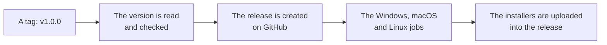

# Development

How to run the app, how to build an installer, and what CI does.

You need [Bun](https://bun.sh), Rust, and Python 3.10+.

## The render service

```bash
cd apps/api
python -m venv .venv
. .venv/bin/activate            # .venv\Scripts\activate on Windows
pip install -e ".[dev]"
uvicorn app.main:app --port 32100
```

WeasyPrint needs Pango and Cairo. On Linux, install the packages listed in
[the CI workflow](../.github/workflows/ci.yml). On Windows, install the GTK3
Runtime, or point `WEASYPRINT_DLL_DIRECTORIES` at a directory that has the
Pango DLLs.

### With Docker

The render service image pins the WeasyPrint version and the system libraries
the visual baselines were produced with:

```bash
cd apps/api
docker compose up --build
```

Or build the image directly, from the root of the repository, because the
build context is the repository root:

```bash
docker build -f apps/api/Dockerfile --target runtime -t yuemi-api .
docker run --rm -p 32100:32100 yuemi-api
```

## The desktop app

```bash
bun install
bun run dev:desktop
```

The app talks to the render service at `http://127.0.0.1:32100` by default.
Change the address in the app's Settings dialog. The port is named once in
`packages/protocol/src/index.ts` and once in `apps/api/app/service.py`; a test
keeps the two in step.

## Tests

```bash
cd apps/api && pytest                    # 144 tests
bun run test                             # 202 desktop tests, 30 protocol tests
cd apps/desktop/src-tauri && cargo test  # 119 tests
```

The visual tests compare the rendered pages of the reference document against
the committed baselines. To regenerate them after a change to the layout
engine that is meant to alter the output:

```bash
cd apps/api && python scripts/render_reference.py --update
```

## Building a binary

The installers for the platform you are on are built with one command:

```bash
bun run build:desktop
```

It prints what the platform needs before it starts, then runs `tauri build`. The
output lands in `apps/desktop/src-tauri/target/release/bundle`:

| Platform | Files |
|---|---|
| Windows | `yuemi_<version>_x64_en-US.msi`, `yuemi_<version>_x64-setup.exe` |
| macOS | `yuemi_<version>_aarch64.dmg`, `yuemi.app.tar.gz` |
| Linux | `yuemi_<version>_amd64.deb`, `yuemi-<version>-1.x86_64.rpm`, `yuemi_<version>_amd64.AppImage` |

The version in the file names comes from `apps/desktop/src-tauri/tauri.conf.json`.
`bun run set-version 1.0.0-beta` puts a different one there and in the other
files that carry it.

The builds are not signed. Windows and macOS will warn about an application
from an unknown developer.

## CI

GitHub Actions runs the backend tests, the frontend tests, a Rust test pass,
a build on Windows, macOS and Linux, and a visual check that renders the
reference document on all three operating systems and compares the pages.
See [.github/workflows/ci.yml](../.github/workflows/ci.yml).

The visual job asks for bash on purpose. A runner on Windows runs a step in
PowerShell by default, and PowerShell does not read a trailing backslash as a
line continuation, so a command spread over several lines that way never
parses there. A test checks that rule for the whole workflow file, because
nothing else in the suite looks at it.

The backend tests run inside the render image, because the visual baselines
were produced by exactly that stack: the same Debian release, the same
Pango, the same WeasyPrint. Running them against the runner's own libraries
would compare the baselines with a slightly different engine, which is a
difference in the environment rather than in the code.

## Releases

A release is built from a tag, and only from a tag. Pushing a tag that names
a version — `v1.0.0` or `v1.0.0-beta` — runs
[.github/workflows/release.yml](../.github/workflows/release.yml), which builds
the installers for Windows, macOS and Linux and attaches them to a GitHub
Release. A tag with a dash in it is published as a pre-release.



The release is created once, before the three platform jobs, so that the
jobs upload into it rather than racing each other to create it. A re-run of
a failed workflow adds to the release that is already there.

The tag's version is written into the tree before the build, so the
installers, the packages and the release page all carry the same number.
See [Building a binary](#building-a-binary) for what the installers are
called.
