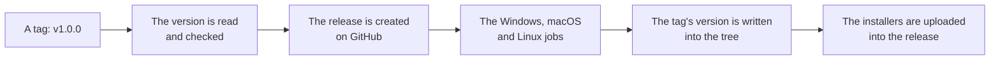

# Development

How to run the app, how to build an installer, and what CI does.

You need [Bun](https://bun.sh), Rust, and Python 3.10+.

## The render service

```bash
cd apps/api
python -m venv .venv
. .venv/bin/activate
pip install -e ".[dev]"
uvicorn app.main:app --port 32100
```

WeasyPrint needs Pango and Cairo. On Linux, install the packages listed in
[the CI workflow](../.github/workflows/ci.yml). On Windows, install the GTK3
Runtime, or point `WEASYPRINT_DLL_DIRECTORIES` at a directory that has the
Pango DLLs.

### With Docker

The render service image pins the WeasyPrint version and the system libraries
the visual baselines were produced with:

```bash
cd apps/api
docker compose up --build
```

Or build the image directly, from the root of the repository, because the
build context is the repository root:

```bash
docker build -f apps/api/Dockerfile --target runtime -t yuemi-api .
docker run --rm -p 32100:32100 yuemi-api
```

## The desktop app

```bash
bun install
bun run dev:desktop
```

The app talks to the render service at `http://127.0.0.1:32100` by default.
Change the address in the app's Settings dialog. The port is named once in
`packages/protocol/src/index.ts` and once in `apps/api/app/service.py`; a test
keeps the two in step.

## Tests

```bash
cd apps/api && pytest
bun run test
cd apps/desktop/src-tauri && cargo test
```

The visual tests compare the rendered pages of the reference document against
the committed baselines. To regenerate them after a change to the layout
engine that is meant to alter the output:

```bash
cd apps/api && python scripts/render_reference.py --update
```

## Building a binary

The installers for the platform you are on are built with one command:

```bash
bun run build:desktop
```

It prints what the platform needs before it starts, then runs `tauri build`. The
output lands in `apps/desktop/src-tauri/target/release/bundle`:

| Platform | Files |
|---|---|
| Windows | `yuemi_<version>_x64_en-US.msi`, `yuemi_<version>_x64-setup.exe` |
| macOS | `yuemi_<version>_aarch64.dmg`, `yuemi.app.tar.gz` |
| Linux | `yuemi_<version>_amd64.deb`, `yuemi-<version>-1.x86_64.rpm`, `yuemi_<version>_amd64.AppImage` |

The version in the file names comes from `apps/desktop/src-tauri/tauri.conf.json`.
`bun run set-version 1.0.0-beta` puts a different one there and in the other
files that carry it.

The builds are not signed. Windows and macOS will warn about an application
from an unknown developer.

## The icons

The icons of the app are not kept in the repository. They are derived from one
picture, `.github/assets/Logo.png`, every time they are needed:

```bash
bun run icons
```

The Tauri CLI does the work, because it is the tool that knows which files
each platform's bundler wants. The pictures it writes land in
`apps/desktop/src-tauri/icons`, which is ignored by Git.

The derivation is a hook in the Tauri configuration, so it happens on its own:

```json
"beforeBuildCommand": "bun run icons && bun run build",
"beforeDevCommand": "bun run icons && bun run dev"
```

The order matters. The Rust side of the app reads the icon of the window into
the binary, and the bundler of every platform reads its own file out of the
same folder, so the icons have to be there before the Rust side is compiled
and not only before the installers are made.

One job does not get the hook: the CI job that runs `cargo test` calls cargo
directly rather than through the Tauri CLI, so the workflow writes the icons
itself before it runs the tests.

## The version

The whole repository has one version. The desktop app and the render service
are two parts of one product, they are released together from one tag, and
they carry the same number.

The version is declared in more than one place, because the toolchains do not
agree on where they read it:

| Project | File | What it holds |
|---|---|---|
| The repository | `package.json` | `version` |
| The desktop app | `apps/desktop/package.json` | `version` |
| The protocol package | `packages/protocol/package.json` | `version` |
| The desktop app | `apps/desktop/src-tauri/tauri.conf.json` | `version`, and the two versions the bundle formats need |
| The desktop app | `apps/desktop/src-tauri/Cargo.toml` | the version of the crate |
| The desktop app | `apps/desktop/src-tauri/Cargo.lock` | the version of the crate, as cargo records it |
| The repository | `bun.lock` | the versions of the workspace packages, as bun records them |
| The render service | `apps/api/pyproject.toml` | the version of the package |
| The render service | `apps/api/app/__init__.py` | `__version__` |
| The render service | `apps/api/app/main.py` | the version of the FastAPI application |

Two commands look after them:

```bash
bun run set-version 1.0.0-beta   # writes the version into every file
bun run version:report           # says what each file carries
```

`version:report` fails when the places disagree, and the ordinary CI runs
it, so a tree that would build the wrong thing is caught before a release
rather than after one.

The rules live in `apps/desktop/src/lib/version.ts`, which is where the
setters are and where the tests check them. A file that is added to the list
of version files is a file that the release workflow writes into, so a new
project has to be added there rather than left to be remembered.

## CI

GitHub Actions runs the backend tests, the frontend tests, a Rust test pass,
a build on Windows, macOS and Linux, and a visual check that renders the
reference document on all three operating systems and compares the pages.
See [.github/workflows/ci.yml](../.github/workflows/ci.yml).

The work the jobs do is in [.github/scripts](../.github/scripts), one script
per job rather than a long step in the workflow file. A workflow is a list of
steps, and a step that is forty lines of shell is not a step. The scripts
are shell scripts, so a step that runs one asks for bash.

The visual job asks for bash on purpose. A runner on Windows runs a step in
PowerShell by default, and PowerShell cannot run a shell script, nor does
it read a trailing backslash as a line continuation. A test checks that
rule for the whole workflow file, because nothing else in the suite looks
at it.

The backend tests run inside the render image, because the visual baselines
were produced by exactly that stack: the same Debian release, the same
Pango, the same WeasyPrint. Running them against the runner's own libraries
would compare the baselines with a slightly different engine, which is a
difference in the environment rather than in the code.

## Releases

A release is built from a tag, and only from a tag. Pushing a tag that names
a version — `v1.0.0` or `v1.0.0-beta` — runs
[.github/workflows/release.yml](../.github/workflows/release.yml), which builds
the installers for Windows, macOS and Linux and attaches them to a GitHub
Release. A tag with a dash in it is published as a pre-release.

The tag is read by `.github/scripts/version-from-tag.sh`, which refuses a tag
that does not name a version, and the release is created by
`.github/scripts/create-release.sh`, which creates it once so that the three
platform jobs upload into it rather than racing each other to create it.



The release is created once, before the three platform jobs, so that the
jobs upload into it rather than racing each other to create it. A re-run of
a failed workflow adds to the release that is already there.

The tag's version is written into the tree before the build, so the
installers, the packages and the release page all carry the same number.
The script that does it is
[.github/scripts/apply-tag-version.sh](../.github/scripts/apply-tag-version.sh),
which reads the version out of the tag and puts it into every file that
carries one. See [The version](#the-version) for where those files are.
