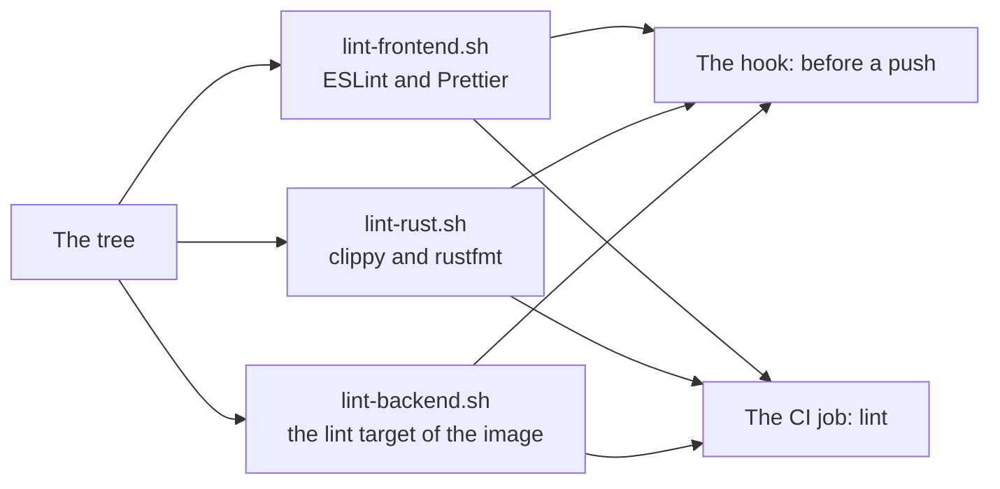

# The linters

How the three languages of the repository are linted, and why each one has
the linter it has.

The tree is written in three languages, and each of them has a linter that
comes with its own toolchain.

| Language | Linter | Formatter | Where the rules live |
|---|---|---|---|
| TypeScript | ESLint | Prettier | `eslint.config.mjs`, `.prettierrc.json` |
| Rust | `cargo clippy` | `cargo fmt` | the toolchain's own defaults |
| Python | `ruff check` | `ruff format` | `apps/api/pyproject.toml` |

Nothing has to be installed for the Rust one, and the Python one runs
inside the image the service ships in, so it sees the same Python as the
service itself.

## Running them

```bash
bun run lint          # ESLint and Prettier over the TypeScript side
bun run format        # Prettier writes the changes back

# The other two are run through the scripts, so the same command runs
# here and in the CI.
.github/scripts/lint-rust.sh
.github/scripts/lint-backend.sh
```

The scripts live in [.github/scripts](../.github/scripts) and the CI runs all
three in its `lint` job. A lint that only runs on the machine of the person
who wrote the code is a lint that is skipped on the day it matters.



## Before a push

The same three linters run before a push, through the hook under
[.husky](../.husky). The CI only speaks after the branch is already on the
server, so a mistake found here arrives while it is still in the working
tree.

The hook calls the same scripts the CI calls, so there is one set of lint
rules and not two.

The hooks are installed by `bun install`, which runs the `prepare` script of
the root manifest. A new contributor does not have to run anything extra.

The lint of the render service needs a Docker daemon. A machine without one
still pushes: the CI lints the service on every push, so nothing is lost,
only moved to the runner. The hook says that it skipped the service, because
a silent skip reads like a lint that passed.

A push that is deliberate and does not need the lint is pushed with:

```bash
HUSKY=0 git push
```

Git's own `--no-verify` does the same thing.

## The TypeScript side

ESLint is used rather than a single bundled tool because the tree already
carries `eslint-disable-next-line react-hooks/exhaustive-deps` comments, and
a linter that does not know that rule name would leave dead directives
behind.

The configuration runs the type-aware rules of `typescript-eslint`, the rules
of `react-hooks` and the rules of `jsx-a11y`. The React rules are on because
they catch defects the type checker cannot: a ref that is read while the
component renders, a state that is set from an effect, a value that is
mutated after a memo was made.

A handful of rules are switched off, and each one says why it is off in the
comment above it. A rule that is off without a reason is a rule that was
silenced rather than fixed, so `apps/desktop/src/lib/lint.test.ts` checks
that every rule that is off carries its reason.

Prettier formats the TypeScript, the CSS and the JSON. It does not touch the
prose, the generated files, the YAML or the Rust side:

- The prose is written to be read, and the way it is wrapped is part of how
  it reads. A formatter would reflow the PRD and the documentation, and the
  result would say nothing that the text did not already say.
- The generated files are written by a script of the service, and the script
  writes them in its own shape, so a formatter here would only make the next
  run of the script change them again.
- The YAML files are read by another program rather than by a person: the
  compose file by Docker, the dependabot file by GitHub. A formatter would
  change the quoting of their strings, and the tests that read them would
  then look for a shape that the file no longer has.
- The Rust side has its own formatter.

## The Rust side

`cargo clippy` and `cargo fmt` come with the Rust toolchain, so nothing has to
be installed for them.

The clippy warnings are errors. A linter whose findings can be ignored is a
linter that is read once and then ignored.

The lint writes the icons before it compiles. The Rust side of the app reads
the icon of the window into the binary, so a compile without the icons
fails.

## The render service

The lint of the service runs inside the render image, because that image is
the stack the service is deployed on and the one the visual baselines were
made with. A lint that ran against a different Python would report a
different set of mistakes than the one that ships.

The image has a `lint` target for it, and that target runs `ruff check` and
`ruff format --check`. The rules live in `apps/api/pyproject.toml`, next to
the dependencies they apply to, so the tree of the service carries its own
rules.

The set of rules is the errors of flake8 — the mistakes that break the
program — together with the import order and the modernisation of the
annotations. The blind exception is not in the set: the renderer and the
warning collector have to survive a document that is damaged, and the places
that catch it say so where they do it.
