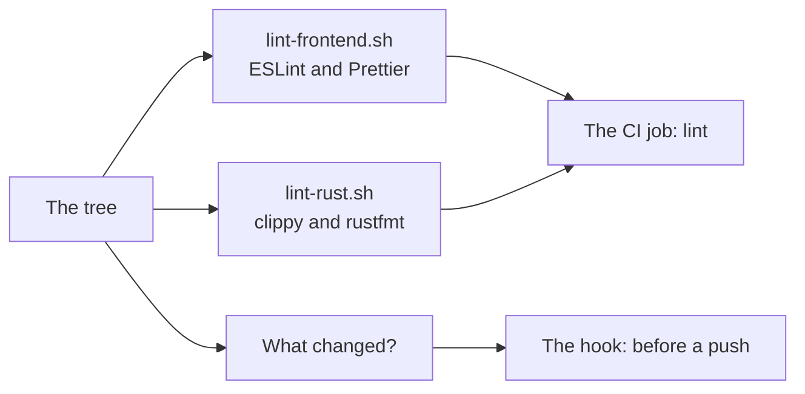
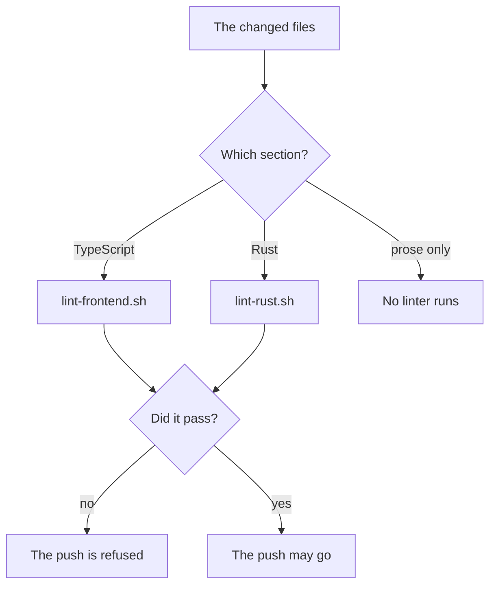

# The linters

How the two languages of the repository are linted, and why each one has
the linter it has.

The tree is written in two languages, and each of them has a linter that
comes with its own toolchain.

| Language | Linter | Formatter | Where the rules live |
|---|---|---|---|
| TypeScript | ESLint | Prettier | `eslint.config.mjs`, `.prettierrc.json` |
| Rust | `cargo clippy` | `cargo fmt` | the toolchain's own defaults |

Nothing has to be installed for the Rust one: Clippy and rustfmt come with
the Rust toolchain.

## Running them

```bash
bun run lint          # ESLint and Prettier over the TypeScript side
bun run format        # Prettier writes the changes back

# The Rust one is run through the script, so the same command runs
# here and in the CI.
.github/scripts/lint-rust.sh
```

The scripts live in [.github/scripts](../.github/scripts) and the CI runs both
in its `lint` job. A lint that only runs on the machine of the person who
wrote the code is a lint that is skipped on the day it matters.



## Before a push

The same two linters run before a push, through the hook under
[.husky](../.husky). The CI only speaks after the branch is already on the
server, so a mistake found here arrives while it is still in the working
tree.

The hook calls the same scripts the CI calls, so there is one set of lint
rules and not two.

The hooks are installed by `bun install`, which runs the `prepare` script of
the root manifest. A new contributor does not have to run anything extra.

### Only the linters that the change reaches

The hook does not run both every time. It asks `scripts/lint-changed.ts`
which linters the changes reach, and runs only those. A push that touched
only the prose would otherwise pay for a Rust compile, and a hook that is
slow is a hook that people learn to push past.

| Section | Lives in | Linted by |
|---|---|---|
| frontend | `apps/desktop/src`, `packages/protocol`, `scripts/`, and the configuration at the root | `lint-frontend.sh` |
| rust | `apps/desktop/src-tauri/` | `lint-rust.sh` |

The rule is per section rather than per file: a whole linter runs or does
not run, so the run on this machine is the same run the CI does for that
section. The rules live in
[apps/desktop/src/lib/changedLinters.ts](../apps/desktop/src/lib/changedLinters.ts),
and the tests next to it check them one by one.

To see what the hook would run, without pushing:

```bash
bun run lint:changed
```

It prints one linter name per line, and prints nothing when the change
reaches no linter.

### What counts as a change

Three things are put together:

- the commits that are not on the upstream yet,
- the changes that are staged or modified in the working tree,
- the files that are new and not ignored.

The new files are in the list because a file that has never been committed is
exactly the file that has not been linted yet.

The changes are measured against the merge base of HEAD and the upstream of
the branch, which is where the two lines parted. A branch that has no
upstream falls back to `origin/master` and then to `origin/main`. When there
is no such ref at all, every linter runs: not being able to tell what
changed is not a reason to skip the lint.



### A red lint stops the push

A linter that finds something returns a non-zero code, the hook turns that
into a refusal, and git refuses the push. The hook says that it refused it,
so the reason the push stopped is on the screen of the person who pushed.

A push that is deliberate and does not need the lint is pushed with:

```bash
HUSKY=0 git push
```

Git's own `--no-verify` does the same thing.

## The TypeScript side

ESLint is used rather than a single bundled tool because the tree already
carries `eslint-disable-next-line react-hooks/exhaustive-deps` comments, and
a linter that does not know that rule name would leave dead directives
behind.

The configuration runs the type-aware rules of `typescript-eslint`, the rules
of `react-hooks` and the rules of `jsx-a11y`. The React rules are on because
they catch defects the type checker cannot: a ref that is read while the
component renders, a state that is set from an effect, a value that is
mutated after a memo was made.

A handful of rules are switched off, and each one says why it is off in the
comment above it. A rule that is off without a reason is a rule that was
silenced rather than fixed, so `apps/desktop/src/lib/lint.test.ts` checks
that every rule that is off carries its reason.

Prettier formats the TypeScript, the CSS and the JSON. It does not touch the
prose, the generated files, the YAML, the Rust side or the agent skills:

- The prose is written to be read, and the way it is wrapped is part of how
  it reads. A formatter would reflow the PRD and the documentation, and the
  result would say nothing that the text did not already say.
- The generated files are written by a script of their own, and the script
  writes them in its own shape, so a formatter here would only make the
  next run of the script change them again.
- The YAML files are read by another program rather than by a person: the
  dependabot file and the workflows by GitHub. A formatter would change
  the quoting of their strings, and the tests that read them would then
  look for a shape that the file no longer has.
- The Rust side has its own formatter.
- The agent skills under `.agents/` carry scripts and examples that are read
  by an agent rather than built by this repository, and their own format is
  part of what they are.

## The Rust side

`cargo clippy` and `cargo fmt` come with the Rust toolchain, so nothing has to
be installed for them.

The clippy warnings are errors. A linter whose findings can be ignored is a
linter that is read once and then ignored.

The lint writes the icons before it compiles. The Rust side of the app reads
the icon of the window into the binary, so a compile without the icons
fails.
